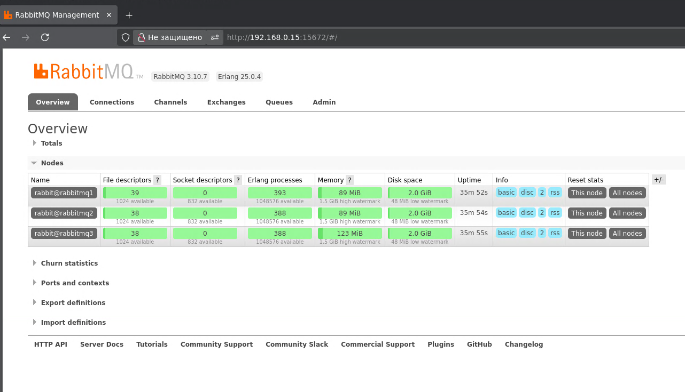
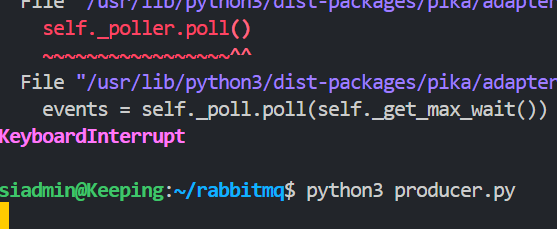
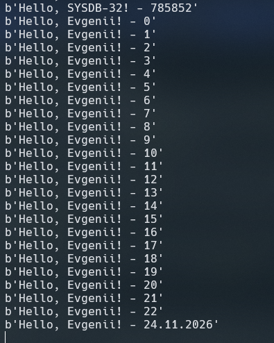
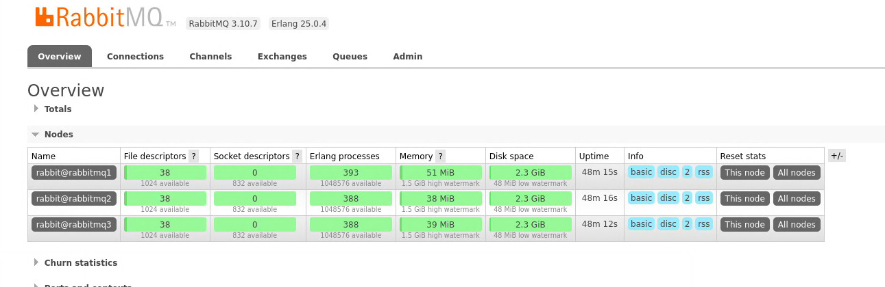
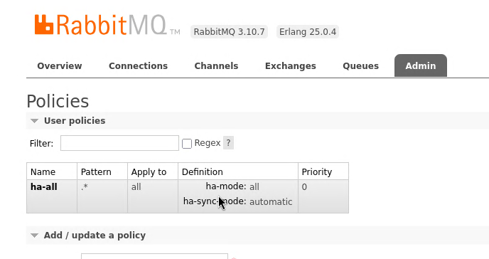
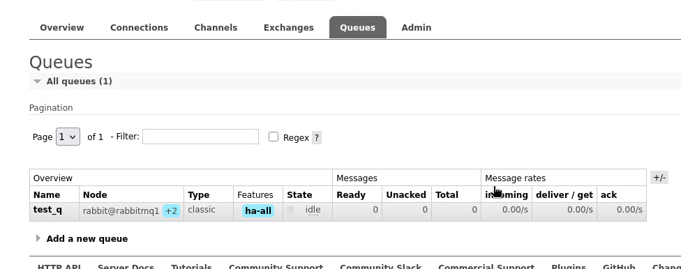
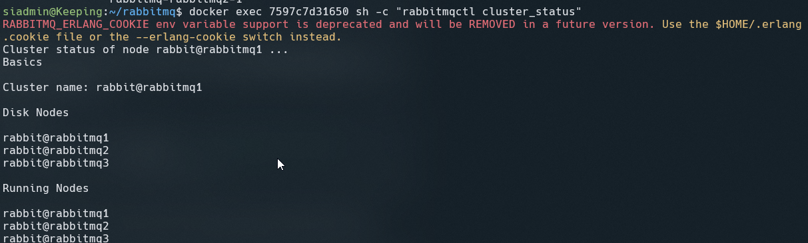
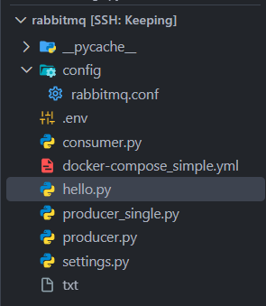
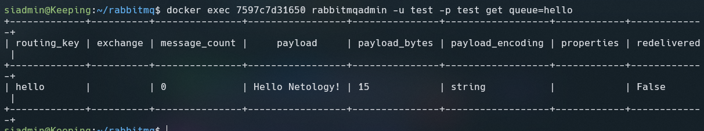
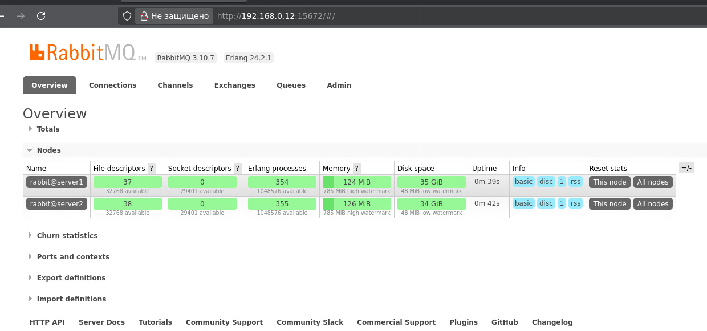

Задание 1. Установка RabbitMQ

Используя Vagrant или VirtualBox, создайте виртуальную машину и установите RabbitMQ. Добавьте management plug-in и зайдите в веб-интерфейс.

Задание 2. Отправка и получение сообщений

Используя приложенные скрипты, проведите тестовую отправку и получение сообщения. Для отправки сообщений необходимо запустить скрипт producer.py.

Зайдите в веб-интерфейс, найдите очередь под названием hello и сделайте скриншот. После чего запустите второй скрипт consumer.py и сделайте скриншот результата выполнения скрипта

Для закрепления материала можете попробовать модифицировать скрипты, чтобы поменять название очереди и отправляемое сообщение.

Задание 3. Подготовка HA кластера

Используя Vagrant или VirtualBox, создайте вторую виртуальную машину и установите RabbitMQ. Добавьте в файл hosts название и IP-адрес каждой машины, чтобы машины могли видеть друг друга по имени.

Пример содержимого hosts файла:

$ cat /etc/hosts

192.168.0.10 rmq01

192.168.0.11 rmq02

После этого ваши машины могут пинговаться по имени.

Затем объедините две машины в кластер и создайте политику ha-all на все очереди.

Также приложите вывод команды с двух нод:

$ rabbitmqctl cluster_status

Для закрепления материала снова запустите скрипт producer.py и приложите скриншот выполнения команды на каждой из нод:

$ rabbitmqadmin get queue='hello'

После чего попробуйте отключить одну из нод, желательно ту, к которой подключались из скрипта, затем поправьте параметры подключения в скрипте consumer.py на вторую ноду и запустите его.

* Задание 4. Ansible playbook

Напишите плейбук, который будет производить установку RabbitMQ на любое количество нод и объединять их в кластер. При этом будет автоматически создавать политику ha-all.

__Задание 1. Установка RabbitMQ__





__Задание 2. Отправка и получение сообщений__


```
docker-compose_simple.py
version: "3.8"

services:
  rabbitmq1:
    image: rabbitmq:3.10.7-management #с веб-интерфесом
    hostname: rabbitmq1
    restart: always
    environment:
      - RABBITMQ_DEFAULT_USER=${RABBITMQ_DEFAULT_USER}
      - RABBITMQ_DEFAULT_PASS=${RABBITMQ_DEFAULT_PASS}
      - RABBITMQ_CONFIG_FILE=/config/rabbitmq
      - RABBITMQ_ERLANG_COOKIE=${RABBITMQ_ERLANG_COOKIE}
      - RABBITMQ_NODE_PORT=5672
    volumes:
      - ./config:/config
    ports:
      - 15672:15672 # для отображения веб интерфейса
      - 5672:5672

consumer.py
import pika
import time

from settings import URI

params = pika.URLParameters(URI)
conn = pika.BlockingConnection(params)
channel = conn.channel()


def callback(ch, method, properties, body) -> None:
    # print(ch, method, properties, body)
    time.sleep(1)
    print(body)


channel.basic_consume(
    queue="test_q",
    on_message_callback=callback,
    auto_ack=True,
    consumer_tag="netology_consumer",
)

if __name__ == "__main__":
    channel.start_consuming()
producer_single.py
import pika

from settings import URI

# params = pika.ConnectionParameters('localhost')
params = pika.URLParameters(URI)
conn = pika.BlockingConnection(params)
channel = conn.channel()

channel.queue_declare(queue="test_q")

if __name__ == "__main__":

    channel.basic_publish(
        exchange="",
        routing_key="test_q",
        body="Hello, SYSDB-32! - 24.11.2026",
    )

```








__Задание 3. Подготовка HA кластера__

















```
hello.py
#!/usr/bin/env python
# coding=utf-8
import pika
from settings import URI

connection = pika.BlockingConnection(pika.URLParameters(URI))
channel = connection.channel()
channel.queue_declare(queue='hello')
channel.basic_publish(exchange='', routing_key='hello', body='Hello Netology!')
connection.close()

```





__Задание 4. Ansible playbook__


```
playbook_Rabbit.yml
- name: Установка RabbitMQ на несколько нод в кластере с политикой ha-all
  hosts: webservers
  become: true  # <-- Включает выполнение через sudo

  vars:
    rabbit_user: test
    rabbit_pass: "test"
    master_node: "server1"
    erlang_cookie: "TODRXNKWPVIRMUDJNQPJ"
 
  tasks:
    - name: 1. Установка hostname на каждом сервере
      hostname:
        name: "{{ inventory_hostname }}"

    - name: 2. Прописывание всех нод в /etc/hosts для резолвинга по именам
      lineinfile:
        path: /etc/hosts
        line: "{{ hostvars[item]['ansible_host'] }} {{ item }}"
        state: present
      loop: "{{ groups['webservers'] }}"

    - name: 3. Обновление пакетов
      apt:
        update_cache: yes

    - name: 4. Установка Erlang и зависимостей
      apt:
        name:
          - erlang-base
          - erlang-asn1
          - erlang-crypto
          - erlang-eldap
          - erlang-ftp
          - erlang-inets
          - erlang-mnesia
          - erlang-os-mon
          - erlang-parsetools
          - erlang-public-key
          - erlang-runtime-tools
          - erlang-snmp
          - erlang-ssl
          - erlang-syntax-tools
          - erlang-tftp
          - erlang-tools
          - erlang-xmerl
        state: present

    - name: 5. Скачивание и установка RabbitMQ 3.10.7
      apt:
        deb: https://github.com/rabbitmq/rabbitmq-server/releases/download/v3.10.7/rabbitmq-server_3.10.7-1_all.deb
        state: present
   
    - name: 6. Остановка RabbitMQ перед заменой cookie
      service:
        name: rabbitmq-server
        state: stopped

    - name: 7. Запись единого .erlang.cookie на обе ноды
      copy:
        content: "{{ erlang_cookie }}"
        dest: /var/lib/rabbitmq/.erlang.cookie
        owner: rabbitmq
        group: rabbitmq
        mode: '0400'

    - name: 8. Запуск службы RabbitMQ
      service:
        name: rabbitmq-server
        state: started
        enabled: yes  
       
    - name: 9. Включение плагина
      command: rabbitmq-plugins enable rabbitmq_management
      register: cmd_result
      changed_when: false

    - name: 10. Вывод результата
      ansible.builtin.debug:
        var: cmd_result.stdout_lines

    - name: 11. Проверка текущего статуса кластера на второй ноде
      command: rabbitmqctl cluster_status
      register: cluster_status
      changed_when: false
      when: inventory_hostname != master_node

    - name: 12. Присоединение второй ноды к главной ноде
      shell: |
        rabbitmqctl stop_app
        rabbitmqctl reset
        rabbitmqctl join_cluster rabbit@{{ master_node }}
        rabbitmqctl start_app
      when:
        - inventory_hostname != master_node
        - "'rabbit@' + master_node not in cluster_status.stdout"

    - name: 13. Создание пользователя-администратора для веб-интерфейса
      community.rabbitmq.rabbitmq_user:
        user: "{{ rabbit_user }}"
        password: "{{ rabbit_pass }}"
        vhost: /
        configure_priv: .*
        read_priv: .*
        write_priv: .*
        tags: administrator
        state: present

    - name: 14. Настройка политики зеркалирования ha-all (на главной ноде)
      community.rabbitmq.rabbitmq_policy:
        name: ha-all
        pattern: ".*"
        vhost: /
        tags:
          ha-mode: all
          ha-sync-mode: automatic
        state: present
      when: inventory_hostname == master_node
   
  handlers:
    - name: Перезапуск RabbitMQ
      service:
        name: rabbitmq-server
        state: restarted


```




